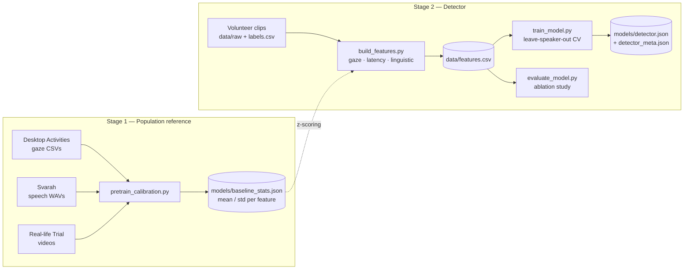

# De-Cue — Detecting Covert Real-Time AI Assistance in Video Interviews

De-Cue looks for signs that a candidate in a video interview is secretly
reading answers from an LLM. It does not inspect the candidate's screen. It
detects the assistance from behaviour: **where the eyes go** (gaze),
**when and how the candidate speaks** (latency), and **what the speech
sounds like** (linguistic features).

> Final year project. This repository covers **Subsystem A (assistant tool)**,
> in `assistant_tool/` and `automated_interview/`, **Subsystem B (data
> pipeline)** and **Subsystem C (detector model)** from Section 4 of the
> project proposal. The web dashboard is a separate component. Background,
> related work, ethics and timeline are in the proposal document.

---

## Contents

- [How it works](#how-it-works)
- [Features](#features)
- [Setup](#setup)
- [Data](#data)
- [Running the pipeline](#running-the-pipeline)
- [Outputs](#outputs)
- [Evaluation methodology](#evaluation-methodology)
- [Using the trained model](#using-the-trained-model)
- [Project layout](#project-layout)
- [Troubleshooting](#troubleshooting)
- [Status](#status)
- [Ethics & data handling](#ethics--data-handling)

---

## How it works

The project runs in **two stages**:



- **Stage 1** uses public datasets to compute a population mean and
  standard deviation for each feature.
- **Stage 2** extracts the same features from a small within-subjects
  volunteer dataset. Each volunteer answers questions both *unassisted* and
  *assisted*. The detector is trained and evaluated on this data.

### What each normalization step does

Put this accurately in the thesis:

| Step | Where | Effect on predictions |
|---|---|---|
| **Stage 1 z-scoring** | `src/baseline_utils.py` | **None.** It re-expresses features as "standard deviations from the population norm", which helps with interpretation and sanity checks. Tree models are unaffected by per-feature rescaling, and the logistic-regression pipeline re-standardizes in every fold. |
| **Per-speaker centering** | `src/modeling_utils.py` | **This is the one that matters.** Each feature is measured relative to that volunteer's own average. The model then sees the within-person change between conditions and not stable personal habits, such as someone who always pauses a lot. |

---

## Features

The detector uses 12 features in three groups. Every extractor returns
`NaN` on failure; it does not crash or make up a value.

| Group | Script | Features | Method |
|---|---|---|---|
| **Gaze** | `extract_gaze.py` | `fixation_stability`, `saccade_rate`, `offcam_deviation`, `blink_rate` | MediaPipe FaceMesh iris tracking, measured relative to the eye corners (cancels head movement and resolution). Uses a fixed-threshold saccade detector and EAR-based blink detection. |
| **Latency** | `extract_latency.py` | `response_delay`, `pause_rate`, `avg_pause_length`, `pause_variance` | WebRTC VAD on 30 ms chunks of 16 kHz mono audio. A chunk only counts as speech if it is also within 30 dB of the clip's loud level, so faint breathing and clicks are ignored; the answer starts at the first speech run of at least 0.3 s. Pause rate is per minute. |
| **Linguistic** | `extract_linguistic.py` | `filler_rate`, `speaking_rate`, `lexical_diversity`, `sentence_complexity` | Whisper `small` transcription with a verbatim prompt so fillers are kept. Fillers are matched as whole words. |

---

## Setup

**Requirements:** Python 3.10+ (tested on Windows) and `ffmpeg`.

```bash
python -m venv venv
venv\Scripts\activate           # macOS/Linux: source venv/bin/activate
pip install -r requirements.txt
```

Install `ffmpeg` system-wide (Whisper and the audio loader need it):

| OS | Command |
|---|---|
| Windows | `winget install ffmpeg` |
| macOS | `brew install ffmpeg` |
| Linux | `sudo apt install ffmpeg` |

On Windows, `paths_config.py` finds a winget-installed ffmpeg on its own,
even when it isn't on `PATH` yet.

### Dependency notes

- Only **`opencv-contrib-python`** is installed. MediaPipe depends on it, and
  installing `opencv-python` alongside it makes the two fight over the `cv2`
  module. Do not add `opencv-python`.
- `numpy` is pinned to `1.26.4` and `mediapipe` to `0.10.14` for compatibility.
- `pyarrow` is only needed by `src/download_svarah.py`.

---

## Data

### Stage 1 — public reference datasets

| Dataset | Used for | Expected location |
|---|---|---|
| Desktop Activities (eye movement, normalised 5-min) | Gaze baseline | `external_data/desktop_activities/*.csv` |
| Svarah (Indian-English speech) | Latency + linguistic baselines | `external_data/svarah/*.wav` |
| Real-life Trial (deception detection videos) | Linguistic baseline | `external_data/real_life_trial/**/*.mp4` |

`src/paths_config.py` checks the local `external_data/` folder first. If a
dataset isn't there, it falls back to the external drive set by
`EXTERNAL_DRIVE_ROOT`. **If the drive letter changes, edit that one line.**
See [external_data/README.md](external_data/README.md) for file counts and
the privacy notice for the Real-life Trial footage.

To export Svarah as WAV files from the Hugging Face parquet cache:

```bash
python src/download_svarah.py
```

### Stage 2 — volunteer recordings

Put the recordings in `data/raw/` (gitignored) and list every clip in
`data/labels.csv`. See `data/labels_template.csv` for the format:

| Column | Description |
|---|---|
| `clip_id` | Unique clip ID, e.g. `v01_assisted_q1` |
| `volunteer_id` | Speaker ID. **All cross-validation splits use this column.** |
| `condition` | `unassisted` or `assisted` |
| `question_num` | Question number within the session |
| `question_type` | e.g. `behavioral` |
| `label` | `0` = unassisted, `1` = assisted |
| `video_path` | Path to the video, absolute or relative to the project root |
| `audio_path` | Optional separate audio file. If empty, audio comes from the video. |
| `question_end_time` | Seconds into the clip where the interviewer's question ends. **Set to `0.0` for clips trimmed per the session protocol**; otherwise `response_delay` is lost. |

Every volunteer must have clips from **both** conditions. Per-speaker
centering depends on this.

---

## Running the pipeline

Run every command from the project root. The scripts don't depend on the
working directory, because all paths are anchored in `src/paths_config.py`.

```bash
# 1. Check that the Stage 1 datasets can be found
python src/pretrain_calibration.py --check-paths

# 2. Build the Stage 1 reference stats -> models/baseline_stats.json
#    Clips listed in data/labels.csv are excluded automatically (no leakage).
python src/pretrain_calibration.py
#    options: --max-latency 500  --max-linguistic 50  --seed 42   (0 = use all)

# 3. Fill in data/labels.csv with your volunteer clips (see "Data" above)

# 4. Extract all 12 features for every labelled clip -> data/features.csv
python src/build_features.py

# 5. Train and evaluate with leave-speaker-out CV, then save the final model
python src/train_model.py
#    options: --model logreg|xgb  --no-speaker-norm  --permutations 1000  --bootstrap 1000
#             --include-excluded   (sensitivity run; see "Excluded volunteers" below)

# 6. Feature-group ablation study (for the evaluation chapter)
python src/evaluate_model.py
#    options: --permutations N (default 0 = skip)  --bootstrap 1000  --include-excluded
```

> **Keep Stage 1 and Stage 2 consistent.** Whenever you change an extractor,
> rerun step 2 and then step 4 so both stages compute features the same way.
> Extractors still work before Stage 1 exists: `baseline_utils.py` falls back
> to raw (un-normalized) values if `models/baseline_stats.json` is missing.

---

## Outputs

| File | Created by | Contents |
|---|---|---|
| `models/baseline_stats.json` | `pretrain_calibration.py` | Population mean/std per feature (Stage 1) |
| `data/features.csv` | `build_features.py` | One row per clip: labels + 12 features |
| `data/cv_results.csv` | `train_model.py` | Metrics for each held-out speaker |
| `data/oof_predictions.csv` | `train_model.py` | One out-of-fold probability per clip |
| `models/detector.json` | `train_model.py` | Final model trained on all data |
| `models/detector_meta.json` | `train_model.py` | Feature list, required preprocessing, CV summary |
| `data/ablation_results.csv` | `evaluate_model.py` | Gaze / latency / linguistic / combined × logreg / xgb, plus the majority-class baseline |
| `data/*_all_volunteers.csv` | both, with `--include-excluded` | The same results with excluded volunteers kept in (sensitivity analysis) |

All generated files are gitignored because they can be recreated and may
contain information derived from participants.

`data/gaze_exclusions.csv` is kept by hand: clips whose gaze features are
invalid (for example, the volunteer's video froze), with a reason for each.
`build_features.py` sets their gaze features to NaN, so training drops them.

### Excluded volunteers

`data/volunteer_exclusions.csv` (`volunteer_id,reason`) is also kept by hand.
It lists whole volunteers for whom the protocol failed, such as someone who
never used the assistant in the assisted round. Their rows stay in
`labels.csv` and `features.csv`; `train_model.py` and `evaluate_model.py`
leave them out at load time, and `detector_meta.json` records who was left
out and why. `--include-excluded` puts them back and writes the results with
an `_all_volunteers` suffix, without saving a model, so the thesis can report
both runs. Only exclude a volunteer for a reason observed independently of
the model's results, never because they scored badly.

---

## Evaluation methodology

### Leave-speaker-out, always

Every script splits by `volunteer_id` and **never** by `clip_id`. Don't
change this. A clip-level split lets the model learn to recognize individual
faces and voices instead of the behavioural signature, which would invalidate
the whole evaluation (proposal Section 4.4).

### What to report

Report the **pooled out-of-fold** numbers that `train_model.py` and
`evaluate_model.py` print, not per-fold averages. Each fold contains only one
speaker's few clips, so per-fold metrics are too noisy to mean much.

| Metric | How it's computed |
|---|---|
| ROC-AUC, balanced accuracy, F1, precision, recall | Computed once over all out-of-fold predictions |
| 95% confidence intervals | Speaker-level bootstrap: speakers, not clips, are resampled because one person's clips are not independent |
| p-value | Permutation test: labels are shuffled **within each speaker**, the full CV is rerun, and the p-value is how often chance matches or beats the real AUC |
| Reference point | Majority-class baseline |

### Models

| Name | Role | Configuration |
|---|---|---|
| `logreg` (default) | Primary model | Standardized, L2-regularized logistic regression with `class_weight="balanced"`. Few parameters, stable on ~100 clips, weights are interpretable. |
| `xgb` | Non-linear comparison | Shallow XGBoost (`max_depth=2`, 100 trees, lr 0.05, subsampling, L2) |

---

## Using the trained model

`models/detector_meta.json` lists the exact preprocessing any consumer, such
as the web dashboard, **must** reproduce:

1. Extract the 12 features for each of the candidate's answers.
2. **Per-candidate centering:** subtract the candidate's mean over all their
   answers from each feature.
3. For logistic regression, score each answer with the formula stored in
   `detector.json`:

   ```
   p = sigmoid(intercept + Σ coef · (x − scaler_mean) / scaler_scale)
   ```

   For XGBoost, `detector.json` is a native XGBoost model file.

Because of step 2, the detector needs **several answers from the same
candidate**. It cannot score one isolated clip.

---

## Project layout

```
de-cue/
├── data/
│   ├── raw/                     # volunteer recordings (gitignored, never commit)
│   ├── labels.csv               # ground truth for each clip
│   ├── labels_template.csv      # example rows in the expected format
│   ├── volunteer_exclusions.csv # whole volunteers left out, with the reason
│   └── gaze_exclusions.csv      # clips whose gaze features are invalid (frozen video)
├── external_data/               # Stage 1 datasets (gitignored)
├── docs/
│   ├── VOLUNTEER_CONSENT_FORM.md
│   ├── SESSION_PROTOCOL_GUIDE.md          # technical session protocol
│   ├── SESSION_PROTOCOL_GUIDE_GENERAL.md  # non-technical session protocol
│   └── VOLUNTEER_DATA_FINDINGS.md         # per-session checks (generated) + interpretation
├── models/                      # generated model artifacts (gitignored)
├── assistant_tool/              # Subsystem A: Wizard-of-Oz assistant for researcher-run sessions; see assistant_tool/README.md
├── automated_interview/         # automatic sessions: remote_session.py + web app; see automated_interview/web/README.md
├── src/
│   ├── paths_config.py          # all paths; the only file to edit when the drive letter changes
│   ├── extract_gaze.py          # MediaPipe FaceMesh -> gaze features
│   ├── extract_latency.py       # WebRTC VAD -> timing/pause features
│   ├── extract_linguistic.py    # Whisper -> linguistic features
│   ├── baseline_utils.py        # Stage 1 z-scoring helper
│   ├── pretrain_calibration.py  # Stage 1: population reference stats
│   ├── build_features.py        # Stage 2: master feature table
│   ├── session_report.py        # per-session checks -> docs/VOLUNTEER_DATA_FINDINGS.md
│   ├── modeling_utils.py        # shared CV, speaker centering, metrics, CIs, permutation test
│   ├── train_model.py           # leave-speaker-out CV + final model export
│   ├── evaluate_model.py        # feature-group ablation study
│   └── download_svarah.py       # Svarah parquet -> WAV export
├── AGENTS.md                    # instructions for AI coding assistants
├── requirements.txt
└── README.md
```

---

## Troubleshooting

| Symptom | Likely cause / fix |
|---|---|
| `--check-paths` finds 0 files | Drive letter changed. Update `EXTERNAL_DRIVE_ROOT` in `src/paths_config.py`, or copy the datasets into `external_data/`. |
| `response_delay` is `NaN` for every clip | `question_end_time` is missing from `labels.csv`. Set it to `0.0` for protocol-trimmed clips. |
| Features aren't z-scored | `models/baseline_stats.json` doesn't exist yet. Run step 2. |
| `ImportError` / `cv2` conflicts | Both `opencv-python` and `opencv-contrib-python` are installed. Uninstall both, then reinstall from `requirements.txt`. |
| Whisper fails to load audio | `ffmpeg` is missing from `PATH`. Install it and open a new terminal. |
| All latency features `NaN` | The audio couldn't be decoded to 16 kHz mono. Check the file with `ffmpeg -i <file>`. |

---

## Status

- [x] Gaze extractor: eye-relative iris tracking, saccades, fixation stability, gaze deviation, EAR blinks
- [x] Latency extractor: WebRTC VAD, response delay, pause rate/length/variance
- [x] Linguistic extractor: verbatim Whisper, filler rate, speaking rate, lexical diversity, sentence length
- [x] Stage 1 calibration: leakage-free and randomly sampled
- [x] Modelling: speaker-centred features, logreg + regularized XGBoost, pooled OOF metrics, bootstrap CIs, permutation test
- [x] Volunteer protocol & documentation ([consent form](docs/VOLUNTEER_CONSENT_FORM.md), [technical protocol](docs/SESSION_PROTOCOL_GUIDE.md), [general protocol](docs/SESSION_PROTOCOL_GUIDE_GENERAL.md))
- [x] Collect real volunteer data: 15 volunteers recorded (V02–V16, plus the V01 pilot), 14 analysed; V08 is excluded (see `data/volunteer_exclusions.csv`)
- [x] Subsystem A: assistant tool for researcher-run sessions (`assistant_tool/`) and automatic browser sessions (`automated_interview/`)
- [ ] Recheck the gaze saccade threshold (`SACCADE_VELOCITY_THRESHOLD = 1.5`) on real webcam clips. Still unvalidated, but the results don't depend on it: dropping `saccade_rate` leaves the AUC unchanged.
- [ ] Web dashboard (separate component); must apply per-candidate centering (see `models/detector_meta.json`)

---

## Ethics & data handling

- Record volunteers only after they sign the
  [consent form](docs/VOLUNTEER_CONSENT_FORM.md), and follow the session
  protocol.
- **Never commit real participant data.** `data/raw/`, generated feature
  tables and model files are gitignored for this reason.
- **Transcripts are not numerical data.** The consent form covers anonymized
  numerical features only, so don't quote volunteers' answers in the thesis,
  and keep documents that do (e.g. `docs/ASSISTED_VS_UNASSISTED_COMPARISON.md`)
  out of git.
- **After grading:** delete `data/raw/` (recordings, session logs and the
  per-session `trial_features.csv`) as the consent form promises, and drop the
  `transcript` column from `data/features.csv`, so only numerical features
  remain.
- The detector outputs a probability, not proof. It is a research prototype
  and must not be used as the only basis for any hiring decision.
